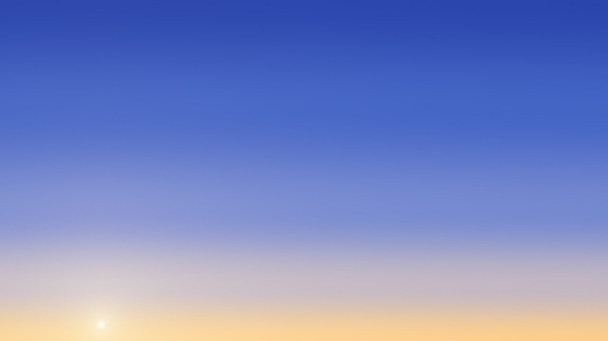
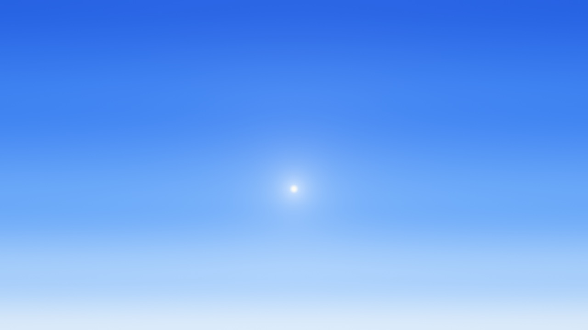
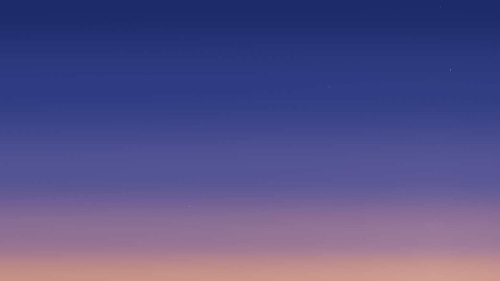
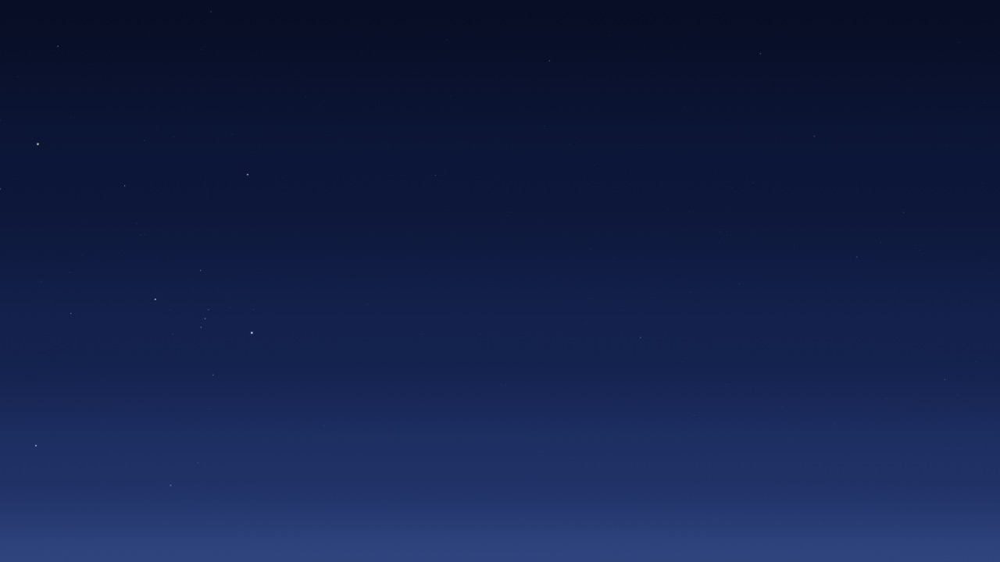

# Sky Wallpaper for macOS

**English** | [简体中文](README_CN.md)

A lightweight, native **Swift + Metal** live sky wallpaper for macOS that renders the real-time rhythm of daylight, twilight, and authentic constellations directly behind your desktop icons and widgets — at native 4K / Retina resolution, in under 1 MB.

<table>
  <tr>
    <td></td>
    <td></td>
  </tr>
  <tr>
    <td align="center"><sub>Sunrise · Royal Cobalt & Apricot</sub></td>
    <td align="center"><sub>Midday · Clear Sky</sub></td>
  </tr>
  <tr>
    <td></td>
    <td></td>
  </tr>
  <tr>
    <td align="center"><sub>Dusk · Blue Hour Twilight</sub></td>
    <td align="center"><sub>Night · Real Constellations (4K)</sub></td>
  </tr>
</table>

## Features

- **Real Astronomical Calculations**: Uses NOAA/Meeus solar & sidereal formulas to compute exact solar altitude, azimuth, sunrise/sunset, daylight duration, lunar phase, and star positions for your location and season.
- **Native 4K / Multi-Display Metal Rendering**: Explicitly locks per-screen `backingScaleFactor` (`3840×2160`, Retina XDR, portrait 4K, etc.) with perceptual multi-band gradients and triangular dithering for zero color banding.
- **3 Visual Styles**:
  - **Pure** *(default)*: Minimalist, crystal-clear atmospheric sky and curated constellations.
  - **Cirrus**: Subtle 6-octave wispy high-altitude clouds during daytime and golden hour.
  - **Deep Cosmos**: Enhanced galactic-plane Milky Way star clusters and subtle dust lanes.
- **Menu Bar Timeline & Live Demo**: Scrub across 24 hours at 60fps, play a smooth full-day demo tour, jump to 6 day phases, toggle optional 3D lunar phase, or return to live time in one click.
- **Zero-Asset Procedural Ambient Wind**: Optional gentle breeze synthesized on the fly via `AVAudioEngine` whose tone shifts between day and night.
- **Private, Lightweight & Non-Intrusive**: ~683 KB binary, no account, no analytics, pauses automatically when displays sleep, and never overwrites your macOS wallpaper or lock screen (quitting immediately restores your original wallpaper).

## Requirements

- macOS 14 (Sonoma) or later (Apple Silicon / Intel)
- Xcode Command Line Tools (`swift`) to build from source

## Quick Start

```bash
git clone https://github.com/Juns-g/sky-wallpaper.git
cd sky-wallpaper

# Run astronomy & star-projection unit tests
swift test

# Build and install to /Applications/Sky.app
bash scripts/build-app.sh --install

# Launch (lives in the menu bar, no Dock icon)
open /Applications/Sky.app
```

### Generate an Offline 4K Preview Gallery

```bash
/Applications/Sky.app/Contents/MacOS/SkyWallpaper --render-preview ./previews
open ./previews/gallery.html
```

## Architecture

- `Sources/SkyCore/` — Pure Swift astronomy engine (`SolarAstronomy`), curated J2000 bright star + Milky Way catalog (`StarCatalog`), city presets & settings (`Models`).
- `Sources/SkyApp/` — Metal fragment/instanced-star shaders (`SkyShaderSource`, `SkyRenderer`), multi-monitor desktop-level window manager (`DesktopWindowManager`), procedural audio (`AmbientWindEngine`), and native SwiftUI menu bar popover (`MenuBarPopoverView`).
- `Tests/SkyCoreTests/` — Unit tests verifying seasonal daylight shifts, Polaris altitude vs. latitude, and day/night visibility.

## License

[MIT](LICENSE)
